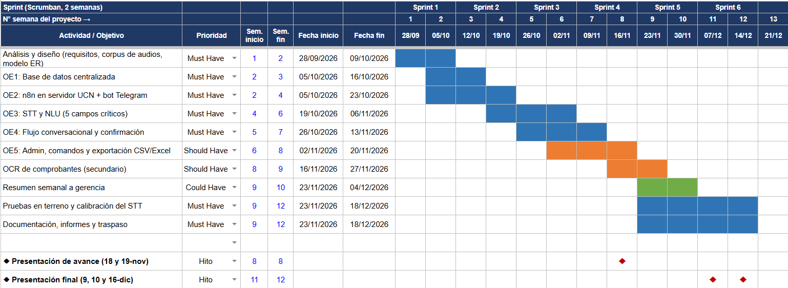

:::::::::: titlepage
::: minipage
{width="2.0cm"}\
:::

 

::: minipage
Universidad Católica del Norte\
Escuela de Ingeniería\
Coquimbo, Chile
:::

::: center
**Capstone Project\
Sistema de Automatización Inteligente y Registro Financiero de Compras**

***Project Charter***
:::

:::: minipage
::: flushleft
*Autor(es):*\
Carlos Tapia\
Javier Dinamarca\
:::
::::

 

:::: minipage
::: flushleft
*Profesor Guía:*\
Juan Bekios\
*Profesor Corrector:*\
Nombre [Profesor Corrector]{.smallcaps}\
*Tutor Empresa:*\
Felipe Campuzano\
Derick Reinhardt
:::
::::

\
2026-10-09\
::::::::::

   **Versión**  **Fecha**    **Autor(es)**             **Breve descripción del cambio**                                                     **Autorizado por**
  ------------- ------------ ------------------------- ------------------------------------------------------------------------------------ --------------------
       0.1      28/03/2025   I. Moraga & V. Briceño    Diseño preliminar de plantilla *Project Charter*.                                    J. Bekios
       1.0      28/09/2026   C. Tapia & J. Dinamarca   Redacción completa del *Project Charter* con enfoque conversacional *audio-first*.   J. Bekios

  -- ---------------------------------------------------------
     Automatización inteligente de compras
     Constructora MYRA (Felipe Campuzano & Derick Reinhardt)
     Carlos Tapia & Javier Dinamarca (Grupo A04)
     Dr. Juan Bekios Calfa
     01/09/2026
     18/12/2026
  -- ---------------------------------------------------------

# Perfil de la Organización

Constructora MYRA es una empresa chilena fundada el 7 de enero de 2022,
especializada en obras de construcción, remodelaciones de corta duración
e infraestructura ligera. Su cartera abarca clientes privados (vivienda)
e institucionales (Universidad Católica del Norte, Puerto de Coquimbo,
Observatorio AURA y sector minero). El ecosistema tecnológico actual se
apoya en WhatsApp para comunicaciones operativas, Microsoft Office 365
(Excel y OneDrive) para gestión administrativa, Fastone para
presupuestación y modelos LLM (ChatGPT) para asistencia técnica.

## Contexto Organizacional

La empresa gestiona en promedio de 5 a 7 proyectos mensuales simultáneos
con rotación semanal. Esto demanda una alta intensidad de adquisiciones
diarias por parte de los jefes de obra (visitando entre 8 y 9
proveedores diarios en promedio). La dinámicas de trabajo bajo presión
obstaculizan el registro manual e inmediato de comprobantes. La ausencia
de un canal ágil de captura genera rezagos en la rendición de cuentas,
postergando la evaluación de rentabilidad por obra y acumulando montos
significativos en cuentas generales sin asignación de proyecto.

## Alcance Geográfico de la Empresa

Las operaciones se concentran en la Región de Coquimbo, Chile
(incluyendo instalaciones en La Rinconada), abarcando centros urbanos,
zonas industriales, faenas mineras e infraestructura institucional.

## Visión de la Empresa

*\[Pendiente de declaración formal. Síntesis basada en metas
operativas:\]*\
Ser una empresa líder en la Región de Coquimbo en la gestión y ejecución
de proyectos de construcción ligera y remodelación, destacada por su
eficiencia operativa, transparencia financiera y adopción tecnológica en
terreno.

## Misión de la Empresa

*\[Pendiente de declaración formal. Síntesis basada en metas
operativas:\]*\
Proveer servicios integrales de construcción y remodelación con altos
estándares de calidad, optimizando el uso de recursos y asegurando la
trazabilidad financiera mediante herramientas de registro accesibles
para el personal de faena.

## Modelo de Generación de Valor

Constructora MYRA genera valor mediante la ejecución acelerada de obras
cortas y la adquisición de insumos optimizada entre proyectos. La
propuesta de valor radica en la capacidad de respuesta, la calidad
técnica y la resolución ágil de requerimientos. El margen operacional
depende directamente del control estricto de los costos directos e
indirectos asignados a cada proyecto.

## Estrategia de la Empresa

La estrategia organizacional busca resguardar los márgenes de utilidad
mediante la asignación del 100% de los costos directos a sus respectivas
obras. La dirección promueve la digitalización de la rendición de gastos
priorizando interfaces por notas de voz, eliminando el procesamiento
manual e integrando la captura de datos antes de los ciclos de
conciliación bancaria.

## FODA: Análisis Estratégico de la Empresa

- **Fortalezas:** Diversificación de clientes (50% privados / 50%
  institucionales), disposición al uso de herramientas digitales (Office
  365, ChatGPT) y alta adaptabilidad operacional en terreno.

- **Oportunidades:** Automatización del reporte de gastos mediante
  asistentes conversacionales de voz integrados a una base de datos
  centralizada en tiempo real.

- **Debilidades:** Dependencia de canales de mensajería no estructurados
  (WhatsApp), fricción en el registro manual por parte del personal de
  faena y desfase en el cálculo de margen por proyecto.

- **Amenazas:** Ruido ambiental que dificulte el procesamiento de voz
  (STT), resistencia a la adopción de nuevas tecnologías e
  incongruencias temporales entre la compra física y el cobro bancario.

# Situación por Abordar

Constructora MYRA presenta ineficiencias en la trazabilidad y captura de
gastos operativos. Actualmente, el flujo de rendición de cuentas se
realiza mediante cuatro grupos informales de WhatsApp. La carga de
trabajo en faena dificulta la interacción con formularios extensos o la
redacción de texto, resultando en retrasos administrativos y la
acumulación de montos no asignados en las cuentas de gastos generales.

## Contexto del Problema

Con una escala operacional de 5 a 7 obras mensuales y visitas continuas
a proveedores, el proceso actual padece las siguientes deficiencias:

- **Comprobantes no trazables:** Las boletas y facturas no incluyen de
  forma nativa la identificación de la obra o centro de costo.

- **Fricción en faena:** La captura manual de datos interrumpe las
  actividades operativas del personal en terreno.

- **Opacidad financiera:** La falta de imputación de costos en tiempo
  real impide determinar la rentabilidad real de los proyectos
  oportunamente.

- **Acumulación de gastos generales:** Distorsión en los estados
  financieros al clasificar costos directos como gastos generales no
  asignados.

- **Carga operativa en administración:** Dedicación excesiva de horas
  hombre en la trascripción e interpretación manual de mensajes
  desestructurados hacia planillas Excel.

## Alcance del Problema

El proyecto prioriza el uso de notas de voz como canal primario para
capturar las cinco variables críticas necesarias para la gestión
administrativa: **Proyecto**, **Monto Total**, **Fecha**, **Proveedor**
y **Medio de Pago/Tarjeta**. El alcance detallado se estructura bajo la
metodología MoSCoW (Tabla [1](#tabla:Moscow){reference-type="ref"
reference="tabla:Moscow"}).

::: {#tabla:Moscow}
+---+------------------------------------------------------------------+
|   |                                                                  |
+:==+:=================================================================+
|   | - Asistente enfocado en notas de voz con módulos Speech-to-Text  |
|   |   (STT) y NLU.                                                   |
|   |                                                                  |
|   | - Extracción obligatoria de 5 variables: Proyecto, Monto Total,  |
|   |   Fecha, Proveedor y Medio de Pago.                              |
|   |                                                                  |
|   | - Flujo de confirmación simple antes de la persistencia de       |
|   |   datos.                                                         |
|   |                                                                  |
|   | - Persistencia centralizada en base de datos relacional.         |
|   |                                                                  |
|   | - Orquestación de flujos de integración en la plataforma n8n.    |
+---+------------------------------------------------------------------+
|   | - Módulo de visión artificial (OCR) para extracción              |
|   |   complementaria desde imágenes de comprobantes.                 |
|   |                                                                  |
|   | - Interfaz de administración para mantención de listas maestras  |
|   |   (proyectos, medios de pago) y exportación a formatos           |
|   |   Excel/CSV.                                                     |
|   |                                                                  |
|   | - Despliegue en servidores de la Universidad Católica del Norte  |
|   |   (UCN) para asegurar costo operacional cero (\$0).              |
|   |                                                                  |
|   | - Comandos de consulta rápida mediante bot (ej. `/proyectos`,    |
|   |   `/resumen`).                                                   |
+---+------------------------------------------------------------------+
|   | - Validaciones automáticas de existencia de proyectos en tiempo  |
|   |   de ejecución.                                                  |
|   |                                                                  |
|   | - Envío automatizado de resúmenes consolidados semanales hacia   |
|   |   la gerencia.                                                   |
+---+------------------------------------------------------------------+
|   | - Algoritmos automatizados de conciliación bancaria.             |
|   |                                                                  |
|   | - Procesamiento de obligaciones tributarias, remuneraciones o    |
|   |   honorarios.                                                    |
|   |                                                                  |
|   | - Adquisición de infraestructura física propia o servicios cloud |
|   |   de alto costo durante la fase académica.                       |
+---+------------------------------------------------------------------+

: Priorización de alcance mediante metodología MoSCoW.
:::

[]{#tabla:Moscow label="tabla:Moscow"}

## Justificación del Problema

El proyecto se fundamenta en los siguientes retornos de valor:

- **Usabilidad operativamente viable:** Minimiza la fricción de uso
  mediante audios cortos en el punto de compra.

- **Control de costos directos:** Asegura la imputación del proyecto al
  inicio del flujo, eliminando gastos huérfanos.

- **Estructuración de datos:** Sustituye la captura informales por
  flujos orquestados en n8n que validan y almacenan datos estructurados.

- **Eficiencia financiera y técnica:** Utiliza la infraestructura
  computacional de la UCN junto a modelos de IA eficientes, logrando una
  solución de costo marginal mínimo.

# Objetivos

## Objetivo General

Desarrollar e implementar un prototipo de asistente virtual interactivo
orientado a voz (*audio-first*) para Constructora MYRA, que automatice
la captura, interpretación y estructuración de los gastos de obra
asegurando la extracción de cinco variables críticas: Proyecto, Monto
Total, Fecha, Proveedor y Medio de Pago con persistencia en una base de
datos centralizada alojada en servidores de la Universidad Católica del
Norte (UCN).

## Objetivos Específicos

- **OE1 (Diseño de la Base de Datos Centralizada):** Diseñar e
  implementar el modelo de datos relacional centralizado que sustituya
  el almacenamiento fragmentado, garantizando la integridad de los datos
  para la conciliación administrativa.

- **OE2 (Orquestación e Infraestructura):** Desplegar la plataforma de
  automatización n8n en los servidores de la UCN, asegurando la
  interconexión entre las interfaces de chat, los modelos de IA y la
  base de datos a costo nulo.

- **OE3 (Procesamiento de Voz e Inteligencia Artificial):** Integrar
  servicios de transcripción (Speech-to-Text) y comprensión de lenguaje
  natural (NLU) para la extracción de contexto desde notas de voz,
  incorporando OCR de comprobantes como función secundaria.

- **OE4 (Diseño Conversacional e Interacción):** Desarrollar un flujo de
  diálogo optimizado que ejecute validaciones en tiempo real y solicite
  confirmaciones ágiles, priorizando la resolución de ambigüedades en el
  campo *Proyecto*.

- **OE5 (Módulo de Administración y Reportabilidad):** Implementar
  capacidades de administración de maestras (proyectos y medios de
  pago), comandos del bot y funcionalidad de exportación de datos a
  formatos CSV/Excel.

# Análisis de la Situación

El problema de gestión en Constructora MYRA reside en la asimetría entre
la velocidad operacional de terreno y los requerimientos de la
administración. Dado que las facturas de proveedores no vinculan el
gasto a un proyecto específico, la imputación depende completamente de
la rendición del trabajador. La solución requiere un sistema asistido
por voz que capture la información en origen de manera transparente para
el operario.

## Alcance del Modelo de Proceso

- **Qué cubre:** Procesamiento de audio (STT/NLU), extracción de los 5
  campos obligatorios, flujo de confirmación rápida, almacenamiento
  estructurado y orquestación sobre n8n alojado en la UCN (con soporte
  secundario OCR).

- **Qué excluye:** Conciliación bancaria automática, liquidación de
  remuneraciones, impuestos y contratación de hosting de pago.

## Valoración de Factores Claves del Proceso

- **Entradas (Inputs):** Notas de voz (mecanismo primario), mensajes de
  texto y fotografías de comprobantes (secundario).

- **Salidas (Outputs):** Registros validados en base de datos
  centralizada, respuestas de confirmación en la interfaz de chat y
  reportes estructurados para finanzas.

- **Variables Críticas:** Niveles de ruido ambiental en faena, precisión
  del STT/NLU y latencia del sistema.

- **Métricas de Operación:** Tiempo promedio de registro ($<60$
  segundos), porcentaje de gastos asignados correctamente a proyectos
  ($100\%$) y tasa de éxito en extracción de los 5 campos básicos.

## Comportamiento de las Métricas de Operación y Resultados

- **Metas Esperadas:** Eliminación de gastos no asignados, reducción del
  tiempo de rendición por compra e visibilidad en tiempo real del margen
  operacional por obra.

- **Medición:** Proporción de registros completos sobre el total
  procesado y tiempo invertido por la gerencia en la conciliación
  semanal.

## Matriz ERRC (Eliminar, Reducir, Aumentar, Crear)

- **Eliminar:** Digitación de formularios extensos en terreno,
  acumulación de gastos sin imputación y trascripción manual de chats
  hacia planillas Excel.

- **Reducir:** Tiempo invertido en la rendición de fondos por compra,
  desfase en la determinación de utilidades y costo de infraestructura
  ($0$ en fase de prueba).

- **Aumentar:** Tasa de imputación de proyectos en origen, precisión de
  costos por obra y velocidad de respuesta.

- **Crear:** Flujo de automatización basado en voz sobre n8n, esquema
  unificado de datos de gastos y repositorio centralizado en servidores
  UCN.

## Trayectoria de las Causas Raíz

La causa raíz es la ausencia del centro de costo en los documentos
tributarios emitidos en ferreterías o proveedores de insumos, combinada
con el entorno dinámico de trabajo en terreno. Al postergarse la
rendición por la fricción de las herramientas tradicionales, el contexto
de la compra se pierde, provocando la acumulación de montos no asignados
en los registros generales.

## Abordaje de Stakeholders

- **Patrocinadores / Gerencia (Felipe Campuzano, Derick Reinhardt):**
  Requieren visibilidad sobre la rentabilidad real de los proyectos.
  Apoyan la solución orientada a iniciar operación formal en 2027. Plan:
  Reportes de avance y demos del flujo conversacional.

- **Personal de Terreno (Jefes de Obra / Compradores):** Exigen una
  solución de fricción mínima. Plan: Uso de notas de voz cortas y
  botones de confirmación de un solo toque.

- **Equipo de Desarrollo (Estudiantes UCN):** Responsables de la
  arquitectura técnica, modelos de IA, despliegue e integración en
  infraestructura universitaria.

# Opciones de Acción

Se evalúan alternativas tecnológicas para tres dimensiones críticas:
alojamiento (hosting), modelos de IA e interfaz conversacional. La
evaluación utiliza tres criterios cuantitativos (escala 1 a 5):

- **Facilidad (5):** Curva de aprendizaje e integración.

- **Tiempo/Costo (5):** Impacto en el cronograma y gasto operacional.

- **Beneficio (5):** Estabilidad, precisión y experiencia de usuario.

   **Opción**        **Dimensión**            **Tecnología / Plataforma**
  ------------ ------------------------- -------------------------------------
       1         Alojamiento (Hosting)       Servidores Universidad (UCN)
       2         Alojamiento (Hosting)    Servicio Cloud de Bajo Costo (VPS)
       3         Alojamiento (Hosting)    Servidor Físico Propio (On-Premise)
       4             Modelo de IA             API Gemini (Capa Gratuita)
       5             Modelo de IA            API Comercial (Pago por Uso)
       6             Modelo de IA            Modelo Local en Servidor UCN
       7        Interfaz Conversacional           Telegram (Bot API)
       8        Interfaz Conversacional          WhatsApp Business API
       9        Interfaz Conversacional             Discord / Slack

  : Opciones tecnológicas por dimensión del proyecto.

   **Opción**   **Facilidad**   **Tiempo/Costo**   **Beneficio**   **Total**  **Argumentación**
  ------------ --------------- ------------------ --------------- ----------- --------------------------------------------------------------------------
       1              4                4                 5            13      Costo \$0; factible y de ágil despliegue en entorno UCN.
       2              4                3                 5            12      Opción de respaldo válida, bajo costo e implementación inmediata.
       3              2                2                 3             7      Elevado costo de hardware y vulnerabilidad en conectividad local.
       4              5                5                 3            13      Capa gratuita idónea para prototipado acelerado.
       5              5                4                 5            14      Costo marginal, alta precisión de procesamiento y estabilidad.
       6              2                2                 3             7      Requiere hardware dedicado y alta complejidad de mantención.
       7              5                5                 3            13      API abierta, gratuita, estable y soporte de componentes interactivos.
       8              2                2                 5             9      Alta familiaridad de usuario, pero barreras de costo y verificación API.
       9              3                3                 2             8      Intuitividad reducida para el perfil de personal operario.

  : Comparación técnica y cuantitativa de alternativas.

   **Dimensión**       **Tecnología Seleccionada**        **Puntaje Total**  
  --------------- -------------------------------------- ------------------- --
    Alojamiento      Servidor UCN / Cloud Bajo Costo           13 / 12       
   Modelo de IA    API Gemini Gratuita / API bajo costo        13 / 14       
     Interfaz               Telegram (Bot API)                   13          

  : Selección de componentes tecnológicos.

# Propuesta de Acción

La propuesta de solución se articula en tres entregables principales
diseñados para garantizar la viabilidad técnica y operativa:

- **Entregable 1: Módulo de Procesamiento de Voz e Inteligencia
  Artificial**\
  Subsistema encargado de la ingesta de notas de voz, conversión STT y
  extracción semántica (NLU) para estructurar los cinco campos críticos
  (Proyecto, Monto, Fecha, Proveedor, Medio de Pago). Incluye como
  función secundaria el procesamiento de imágenes de boletas vía OCR.\
  **Criterios de aceptación:** Tasa de extracción precisa superior al
  80% en audios con ruido ambiental moderado y respuestas procesadas
  dentro de los tiempos límite.

- **Entregable 2: Flujo Conversacional Orquestado**\
  Lógica de interacción implementada en n8n para la gestión de diálogo.
  Solicita la subsanación de campos faltantes (con énfasis en el
  *Proyecto*) y presenta resúmenes de confirmación antes del registro
  persistente.\
  **Criterios de aceptación:** Imposibilidad de persistencia de
  registros sin proyecto asignado y tiempo de registro inferior a 60
  segundos en flujos completos.

- **Entregable 3: Base de Datos, Módulo Administrativo y Despliegue
  UCN**\
  Persistencia relacional para los datos estructurados, panel de
  administración para maestras y exportación de reportes CSV/Excel,
  desplegados integralmente en infraestructura UCN a costo cero.\
  **Criterios de aceptación:** Persistencia íntegra de los 5 campos
  obligatorios, exportación correcta de planillas y disponibilidad
  continua en servidores universitarios.

# Estrategia de Desarrollo

## Metodologías

Se adoptará un **enfoque híbrido** que combina la previsibilidad de los
marcos tradicionales para el cumplimiento de hitos académicos con
metodologías ágiles para el desarrollo iterativo del prototipo.

### Modelos Tradicionales (Gestión de Hitos)

- **Planificación Temporal:** Estructuración mediante Carta Gantt
  dividida en fases: Análisis, Diseño, Desarrollo, Pruebas e
  Implementación.

- **Dependencias Secuenciales:** La construcción de los módulos de IA
  (OE3) está supeditada al despliegue de n8n (OE2) y la base de datos
  relacional (OE1).

- **Margen de Contingencia:** Asignación de una fase final de ajuste
  para la calibración del modelo STT ante ruido de faena.

### Modelos Ágiles (Desarrollo del Prototipo)

Se aplicará la metodología **Scrumban** para la construcción iterativa:

- **Sprints Bisemanales:** Ciclos de desarrollo de dos semanas
  orientados a entregables incrementales funcionalmente validados.

- **Gestión Visual (Kanban):** Tablero de seguimiento categorizado en
  *Por Hacer*, *En Proceso*, *En Pruebas* y *Finalizado*.

- **Artefactos y Priorización:** Mantenimiento del *Product Backlog*
  priorizado según MoSCoW.

- **Reuniones de Control:** Sincronizaciones periódicas del equipo de
  desarrollo con el profesor guía y la contraparte técnica de la
  empresa.

## Justificación de la Estrategia de Desarrollo Propuesta

El enfoque híbrido es el que mejor se ajusta a las restricciones del
proyecto. Por un lado, la dimensión predictiva (Cascada) garantiza el
cumplimiento estricto de las fechas límite, entregables y evaluación
formal del periodo académico universitarios. Por otro lado, la dimensión
ágil (Scrumban) permite iterar rápidamente en la afinación de los
modelos de voz (Speech-to-Text) e IA, adaptando la interacción del bot a
la retroalimentación real de los jefes de obra sin desestabilizar la
planificación global.

## Dinámica, Actividades, Artefactos y Roles Claves

- **Roles y Responsabilidades:**

  - **Product Owner / Contraparte Cliente (Felipe Campuzano y Derick
    Reinhardt):** Definen prioridades del negocio, validan el esquema de
    5 datos críticos y evalúan las demostraciones funcionales del
    prototipo.

  - **Scrum Master / Asesor Técnico (Profesor Guía UCN):** Orienta la
    arquitectura del proyecto, supervisa el cumplimiento metodológico y
    facilita el acceso a la infraestructura de servidores de la
    universidad.

  - **Equipo de Desarrollo (Estudiantes UCN):** Diseñan la base de datos
    relacional, orquestan los flujos en n8n, integran las APIs de IA
    (voz/NLU) y despliegan la aplicación en los servidores UCN.

- **Dinámica de Trabajo y Eventos:**

  - **Planificación de Sprint:** Selección de historias de usuario del
    \*Backlog\* para trabajar durante las siguientes dos semanas.

  - **Demostración y Validación (Reviews):** Muestras del bot en
    funcionamiento ante los socios de MYRA para ajustar la interacción
    antes de avanzar al siguiente módulo.

- **Artefactos:** \*Product Backlog\* priorizado, Tablero Kanban de
  seguimiento, Contenedores Docker/Instancia n8n y Base de Datos
  Relacional desplegada en UCN.

## Despliegue temporal de la estrategia de desarrollo propuesta

<figure id="fig:gantt" data-latex-placement="H">
<table>
<tbody>
<tr>
<td style="text-align: left;"></td>
<td style="text-align: left;">Must Have</td>
<td style="text-align: left;"></td>
<td style="text-align: left;">Should Have</td>
<td style="text-align: left;"></td>
<td style="text-align: left;">Could Have</td>
<td style="text-align: left;"></td>
<td style="text-align: left;"></td>
</tr>
</tbody>
</table>

<figcaption>Carta Gantt del proyecto con hitos y sprints
(Scrumban).</figcaption>
</figure>

## Matriz de Riesgos y Estrategias de Mitigación

- **Riesgo 1: Audio con alto ruido ambiental de faena.**\
  *Mitigación:* Incorporar \*prompts\* del modelo de lenguaje que
  manejen ambigüedad y configurar un flujo interactivo donde el bot
  presente un resumen de los 5 datos extraídos para confirmación rápida
  del trabajador.

- **Riesgo 2: Omisión del nombre del proyecto en la nota de voz.**\
  *Mitigación:* Programar en n8n una regla que identifique la ausencia
  del campo *Proyecto* y gatille automáticamente una sola pregunta
  directa para que el usuario responda con el nombre de la obra antes de
  guardar.

- **Riesgo 3: Caídas puntuales o inestabilidad del servidor
  universitario.**\
  *Mitigación:* Mantener respaldos automáticos diarios de la base de
  datos y empaquetar toda la solución en contenedores Docker para
  permitir la migración o ejecución local inmediata en caso de
  contingencia.

- **Riesgo 4: Resistencia del personal de terreno a adoptar el canal
  conversacional.**\
  *Mitigación:* Priorizar la interacción por notas de voz cortas ($<60$
  segundos) e implementar botones de confirmación de un solo clic,
  reduciendo al mínimo el esfuerzo operativo requerido en faena.

- **Riesgo 5: Inconsistencia entre nombres de proyectos al mencionarlos
  por voz.**\
  *Mitigación:* Implementar algoritmos de búsqueda difusa (\*fuzzy
  matching\*) en la base de datos contra el catálogo oficial de
  proyectos activos de Constructora MYRA.

# Jira

**Instrucción:** Describir brevemente (2--3 líneas) cómo se gestionará
el proyecto en Jira (sprints, tableros, roles).
